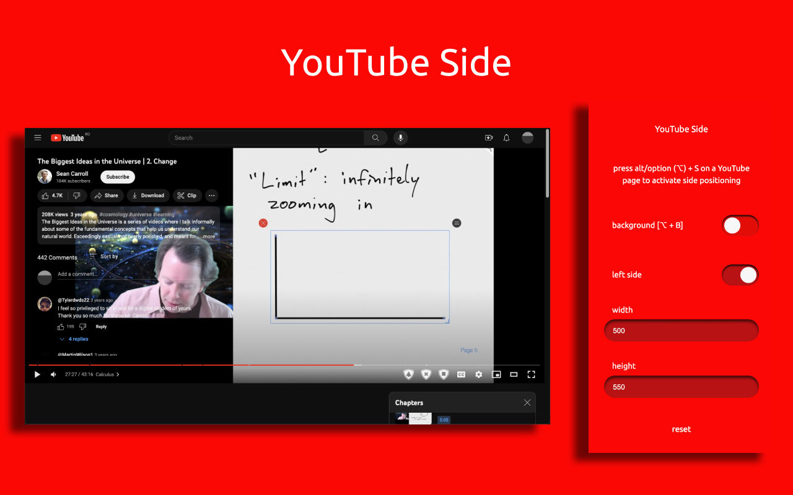

# YouTube Side

YouTube Side is a Chrome extension that shows the YouTube video description, comments, and live chat beside the video instead of below it, so the supporting information can be read without scrolling away from the picture.

<p align="center">
    
</p>

The extension is available for [Chrome](https://chrome.google.com/webstore/detail/youtube-side/ehjnomdbkamcdhadcaghaflklcfhgonl).

## How it works

Press **Alt/Option + S** on a YouTube page to lift the details panel beside the video; press it again to restore the original layout. The panel keeps YouTube's own content — the extension only repositions it.

- **Alt/Option + S** toggles the side panel.
- **Alt/Option + B** switches between a transparent and a themed background; the themed background's blur and opacity are independently adjustable from the popup.
- **Alt/Option + L** moves the panel to the left or right edge.
- **Alt/Option + R** shows or hides the recommendations column.
- **Alt/Option + T** cycles the study views (Side, Transcript, Chapters, Notes) while the panel is open; the arrow keys also move between the view tabs.
- The popup's **side position** switch toggles the layout for the current tab, same as Alt/Option + S; the popup talks to the YouTube page over extension messaging, so no extra permission is needed.
- The popup's **invert text** control inverts the panel's text and background colors while keeping avatars and thumbnails intact - useful when a transparent panel sits over a bright video. In **auto** mode the extension samples the video region behind the panel about once a second and inverts only while that area is bright, with hysteresis so scene cuts do not cause flicker. Frames never leave the page.

### Adaptive Layout

- **Anchor Modes**: Position the panel anchored to the viewport edge or aligned with the video player (`viewport` vs `player`); a player-anchored panel follows the player in theater mode and as the page scrolls.
- **Player-Mode Awareness**: Suspends the side panel in fullscreen and in the miniplayer, and restores it with the same size and position when you return. Picture-in-picture keeps the panel open.
- **Contextual Activation Rules**: Automatically activate Side layout depending on video context: `never`, `live` (live streams), `long` (videos of 20 minutes or more, decided once the video's own duration is known, never from a pre-roll ad), or `always`. Closing the panel yourself always wins for the rest of that video.
- **Per-Channel Rules**: Set custom overrides for specific channels to `always` or `never` open in Side layout. Rules are applied only once YouTube shows the new video's channel, so they never act on the previous video's channel.
- **Viewport Presets**: Overlay `standard`, `live`, or `theater` presets on the base settings. A size you set by dragging or in the popup always wins over the player-derived height.

### Study Mode

- **Transcript Viewer**: Searchable (case- and accent-insensitive), seekable transcript that can follow playback; scrolling the list yourself pauses following until you resume it. The transcript comes from YouTube: when YouTube's caption files can be read directly they are used, otherwise opening the Transcript view opens YouTube's own transcript panel, reads it, and closes it again. If YouTube cannot load a transcript, the view says so and offers a retry.
- **Chapter Navigation**: The video's chapters with the current chapter highlighted and seek on click.
- **Notes & Bookmarks**: Capture the current moment with one click (labelled with the current chapter), edit labels and notes inline, and keep them per video in local extension storage (up to 50 videos, 200 bookmarks each). If storage rejects a save, the panel tells you.
- **Markdown Export**: Copy or download your bookmarks and notes for a video as Markdown. Exports never include transcript text.

While the panel is open with study mode on, clicking YouTube's own **Show transcript** button also brings the transcript into the Transcript view.

The panel can be resized directly by dragging its bottom corner (always the corner facing the page content) - the size is remembered. The popup configures the background, blur strength, background opacity, side, exact width and height, and recommendations. Preferences are shared through extension storage and are validated on every read: dimensions are clamped to sensible bounds (width 320–1200, height 240–1200), so a corrupted value can never break the layout. The layout is applied through a scoped stylesheet and data attributes, never by overwriting YouTube's own inline styles, and it survives YouTube's in-page navigation.

## Scope and permissions

The content script runs only on YouTube. The manifest requests only the `storage` permission; it has no background service, remote code, analytics, or network permission. The shortcuts are handled inside each YouTube page, so one tab cannot toggle another, and they are ignored while typing in the search box, comments, or any other text field.

The only network activity is in the Transcript view, and only after you open it: the page may request a caption file from YouTube itself (the same request YouTube's player makes), or open YouTube's own transcript panel, which loads the transcript the way YouTube always does. Transcripts are kept in memory for the last three videos and are never stored or exported. Bookmarks and notes stay in local extension storage.

## Development

Requirements:

- Node.js 24 or newer
- pnpm 11.15.1

```sh
cd packages/youtube-side-chrome
pnpm install --frozen-lockfile
pnpm check
```

The TypeScript target is ES2024. `pnpm check` validates peer dependencies, formatting/linting, strict types, coverage thresholds, the production Webpack build, the manifest/package file allowlist, bundle budgets, and the Chrome Web Store archive.

Useful commands:

```sh
pnpm typecheck
pnpm test
pnpm test:coverage
pnpm build
pnpm package
```

The unpacked extension is written to `distribution/`; the versioned store archive is written to `distribution-zip/`.

To test locally, run `pnpm build`, open `chrome://extensions`, enable Developer mode, choose **Load unpacked**, and select `packages/youtube-side-chrome/distribution`.

See [docs/ARCHITECTURE.md](docs/ARCHITECTURE.md) for how the extension works, its design rules, the YouTube page facts it depends on, the release checklist, and possible next steps.
